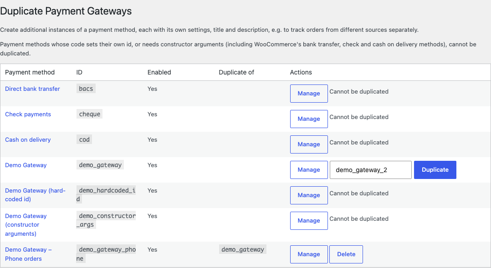
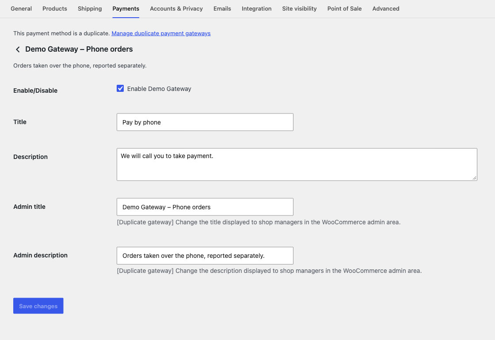
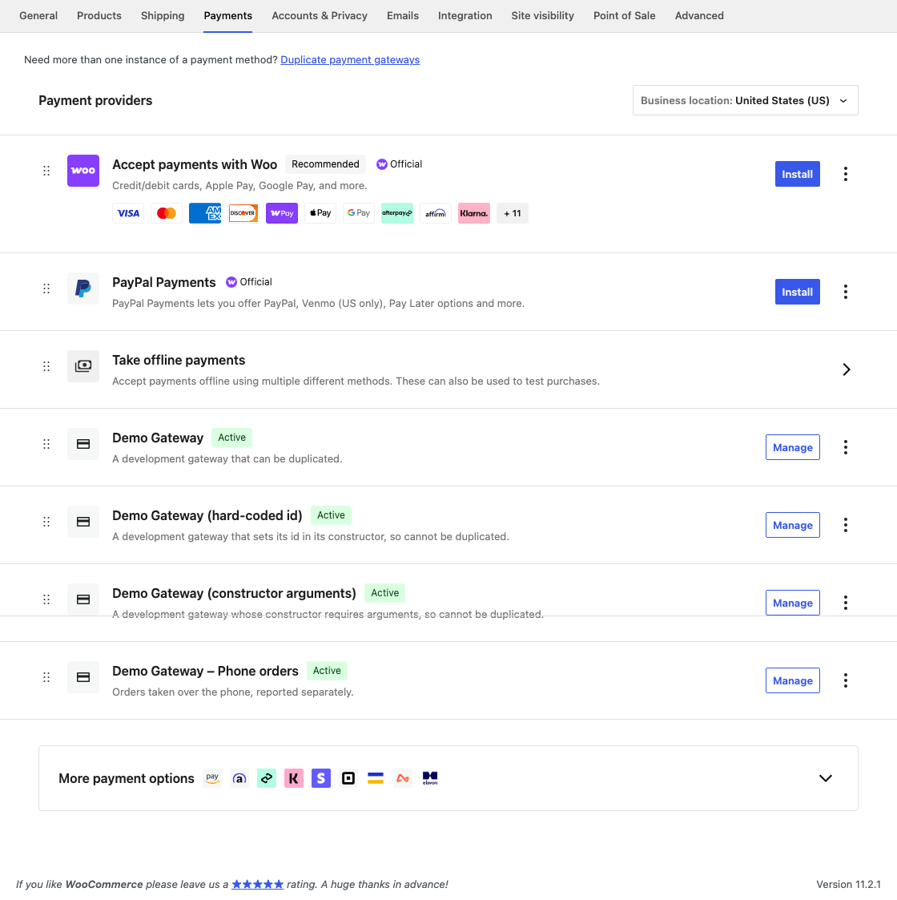
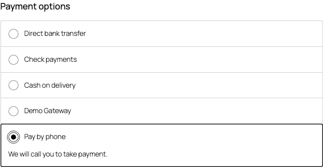
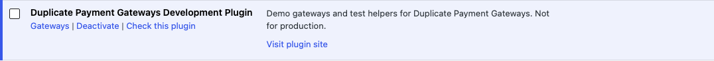

[](https://wordpress.org/plugins/woocommerce/) [](https://github.com/WordPress-Coding-Standards/WordPress-Coding-Standards) [](https://github.com/szepeviktor/phpstan-wordpress)

# Duplicate Payment Gateways

Create additional instances of a WooCommerce payment gateway, each with its own settings, title and description – e.g. to take phone orders with a copy of a gateway so they are reported separately.

NB: not every gateway can be duplicated. Gateways whose constructors set their own id (including WooCommerce's bank transfer, check and cash on delivery) or require arguments (e.g. WooCommerce Payments) are listed as "Cannot be duplicated".

## Use

**WooCommerce / Duplicate Gateways** lists every gateway. Enter a new id and click "Duplicate":



Each duplicate is then configured like any other gateway, under WooCommerce / Settings / Payments, with two extra settings: an admin title and admin description shown to shop managers:



To stop offering a duplicate, untick its "Enable" checkbox. Its orders keep its title and are still reported separately.

Until an admin title is set, a duplicate's id is appended to its title in WooCommerce / Settings / Payments, to tell it apart from the original:



Duplicates are available in the block checkout (and the shortcode checkout) when the gateway's own block checkout integration supports them (see below), or, for gateways without payment fields, with their title and description:



Plugins whose gateways have been duplicated get a "Gateways" link on plugins.php listing their gateways and duplicates:



### Filters

* `bh_wc_duplicate_payment_gateways_register_blocks_integration` `( bool $register, WC_Payment_Gateway $duplicate )` – whether to register the generic block checkout integration (title and description, no payment fields) for a duplicate. Default: when the gateway has no payment fields.

### Supporting duplicates in a gateway's block checkout integration

Gateway plugins register their block checkout integration (an `AbstractPaymentMethodType`) for their own gateway id, and their script calls `registerPaymentMethod()` with that id. For each duplicate, this plugin registers a new instance of the original gateway's integration, constructed with the duplicate, when:

1. the integration's constructor takes the gateway (its only required parameter, typed as the gateway's class), and
2. it sets its name from that gateway's id:

```php
public function __construct( My_Gateway $gateway ) {
	$this->gateway = $gateway;
	$this->name    = $gateway->id;
}
```

Its script must then register every payment method it has data for, rather than a hardcoded name, e.g. by adding a marker to `get_payment_method_data()`:

```js
const paymentMethodData = wc.wcSettings.getSetting( 'paymentMethodData', {} );
Object.keys( paymentMethodData )
	.filter( ( name ) => paymentMethodData[ name ].is_my_gateway )
	.forEach( ( name ) => registerPaymentMethod( { name, /* ...using paymentMethodData[ name ] */ } ) );
```

Payment field names should include the gateway id, so a duplicate's fields do not collide with the original's in the shortcode checkout. See the development plugin's [`Demo_Gateway_With_Fields_Blocks`](development-plugin/gateways/class-demo-gateway-with-fields-blocks.php) and [its script](development-plugin/assets/demo-gateway-with-fields-blocks.js).

Alternatively, a gateway plugin can register its integration for every instance of its gateway itself; this plugin does not register one for a duplicate that already has one.

## Develop

Requires Docker, Node (see `.nvmrc`) and PHP 8.4 + Composer.

```bash
composer install
npm install
npx wp-env start
```

* Site: http://localhost:8890 – `admin` / `password`. Also `customer` and `shopmanager`, password `password`.
* MySQL: `127.0.0.1:33062`, `root` / `password`.

[`tests/_wp-env/initialize-internal.sh`](tests/_wp-env/initialize-internal.sh) configures the site on each start: WooCommerce pages, `/checkout-blocks/` and `/checkout-shortcode/` pages, a test product, the offline gateways enabled, and a demo duplicate.

### Development plugin

[`development-plugin`](development-plugin) is active in wp-env only (it is not in the plugin zip). It demonstrates which gateways can be duplicated:

| Gateway | Id | Duplicable? |
|---|---|---|
| [`Demo_Gateway`](development-plugin/gateways/class-demo-gateway.php) | `demo_gateway` | Yes: it only sets `$this->id` when it is not already set. It has its own block checkout integration, as a gateway plugin would. |
| [`Demo_Gateway_With_Fields`](development-plugin/gateways/class-demo-gateway-with-fields.php) | `demo_gateway_fields` | Yes, with its payment field in the block checkout: its block checkout integration takes its name from the gateway it is constructed with. |
| [`Demo_Gateway_Hardcoded_Id`](development-plugin/gateways/class-demo-gateway-hardcoded-id.php) | `demo_hardcoded_id` | No: it always sets its id in its constructor. |
| [`Demo_Gateway_With_Constructor_Arguments`](development-plugin/gateways/class-demo-gateway-with-constructor-arguments.php) | `demo_constructor_args` | No: its constructor requires arguments. |

and adds REST endpoints for arranging E2E tests, `/wp-json/bh-wc-duplicate-payment-gateways-development/v1/duplicates` (see [`class-duplicates.php`](development-plugin/rest/class-duplicates.php)).

### Tests

```bash
composer test              # Codeception unit, wpunit and integration suites; wpunit/integration use the wp-env MySQL.
npm run test:e2e           # Playwright, against http://localhost:8890.
npm run test:e2e:report
```

Playwright tests arrange state with REST/WP-CLI and use the UI only for what is being tested. They run with one worker, since all duplicates are saved in one option.

### Lint

```bash
composer cs-fix            # phpcbf, phpcs (WPCS + plugin-check), phpstan level 8.
npm run lint:js
npm run typecheck
```

### Build

```bash
composer create-plugin-archive
```

## How it works

A gateway is duplicated by creating an anonymous subclass of it which sets the new id before calling the parent constructor. Since a class cannot extend a variable, each gateway class is first given a `class_alias()` (`Gateway_0` … `Gateway_30`), and the anonymous classes extend those. See [`Payment_Gateways::add_gateways()`](src/woocommerce/class-payment-gateways.php).
